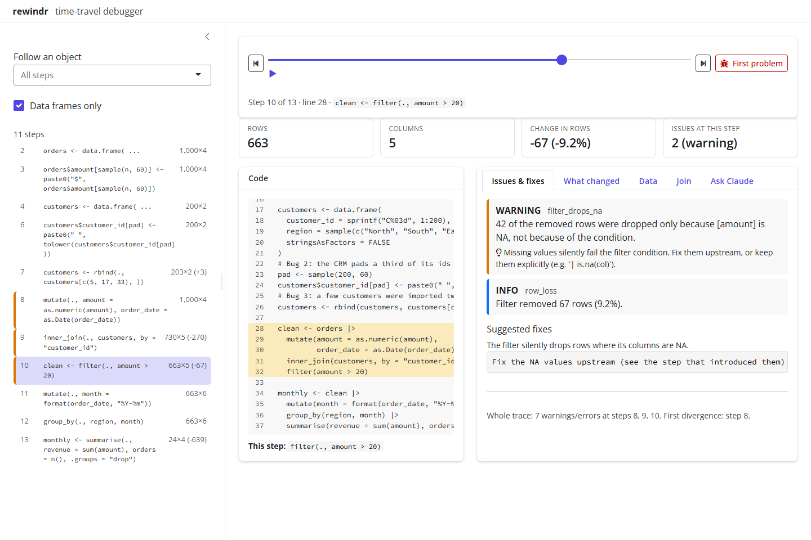
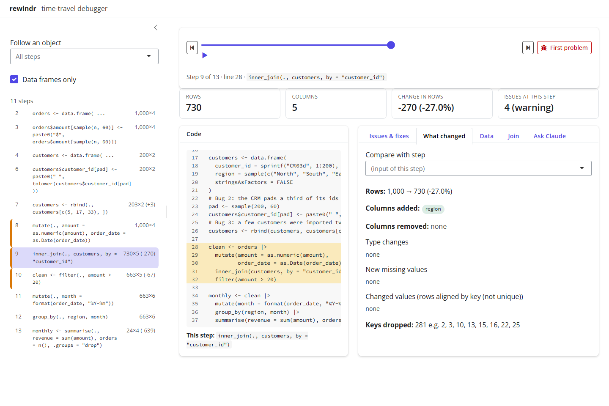
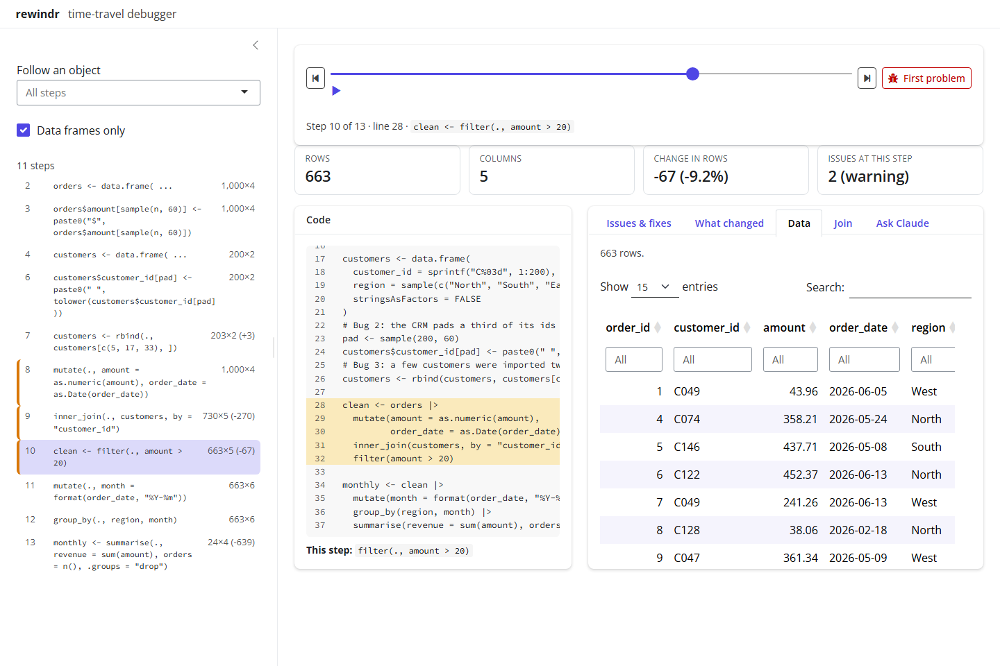
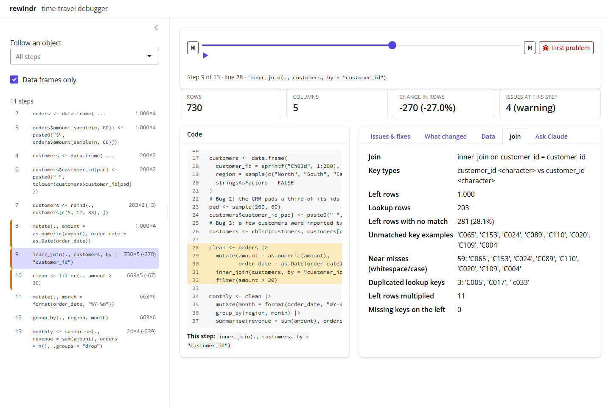
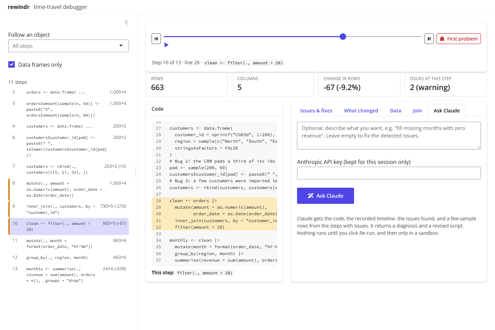

```{r, include = FALSE}
knitr::opts_chunk$set(collapse = TRUE, comment = "#>", eval = FALSE)
```

`scrub()` opens any recording as an interactive app. These screenshots use
the bundled demo pipeline:

```{r}
library(rewindr)
tr <- rewind_script(rewind_example(), key = "order_id")
scrub(tr)
```

In RStudio, the **Addins → Rewind current script** command does both steps
and opens the app in the Viewer pane.

## The timeline


* **Left:** every recorded step, with the rows × columns after it and the
  change in rows. A coloured bar marks steps with issues (orange for
  warnings, red for errors, blue for information). Click a step to jump to
  it. *Follow an object* narrows the list to the steps that built one data
  frame, and *Data frames only* hides scalars and helper objects.
* **Top:** the scrubber. Drag it, press ▶ to play through the steps, or use
  the ← and → keys. **First problem** jumps to the first warning or error.
* **Stat tiles:** rows, columns, change in rows and issues for the current
  step.
* **Code:** the whole script with the current statement highlighted (red if
  it failed), and below it the exact stage that ran.

## Issues and fixes



This tab explains what is wrong at the current step and shows the fix that
`suggest_fixes()` proposes. The last line summarises the whole recording.

## What changed



Rows before and after, columns added and removed, type changes, new missing
values per column, and changed cells. With a `key`, it also lists the
dropped keys. *Compare with step* compares any two states, not just a step
and its input.

## Data



The data as it was at that step: up to 5,000 rows, with a filter box for
every column. Rows that changed at this step are highlighted in yellow and
new columns are tinted green.

## Join report



For joins (`*_join()` from dplyr and `merge()`), this tab shows:

* how many left-hand rows found no match, with examples;
* **near misses**: unmatched keys that would match after trimming whitespace
  or ignoring case, the most common silent join bug;
* duplicated keys in the lookup table, and how many rows they multiplied;
* missing keys and key type mismatches.

## Ask Claude



Type what you want, or leave the box empty to fix the detected issues, and
click **Ask Claude**. The response has a diagnosis, a list of changes and
the full revised script. **Re-run revised code in a sandbox** records the
new version and compares it with the original, object by object, including
how many warnings and errors are left. **Scrub the new run** switches the
app to the new recording, and you can download the revised script.

This tab needs an Anthropic API key, either in the `ANTHROPIC_API_KEY`
environment variable or pasted into the app (it is kept only for the
session). Everything else in the app works offline. See
[Fixing code and shipping it](fixing-and-shipping.html) for exactly what is
sent.
